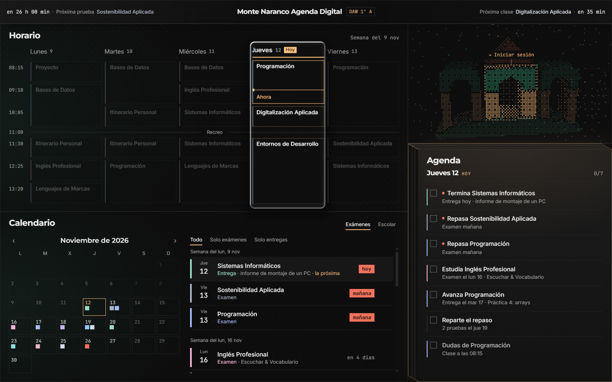
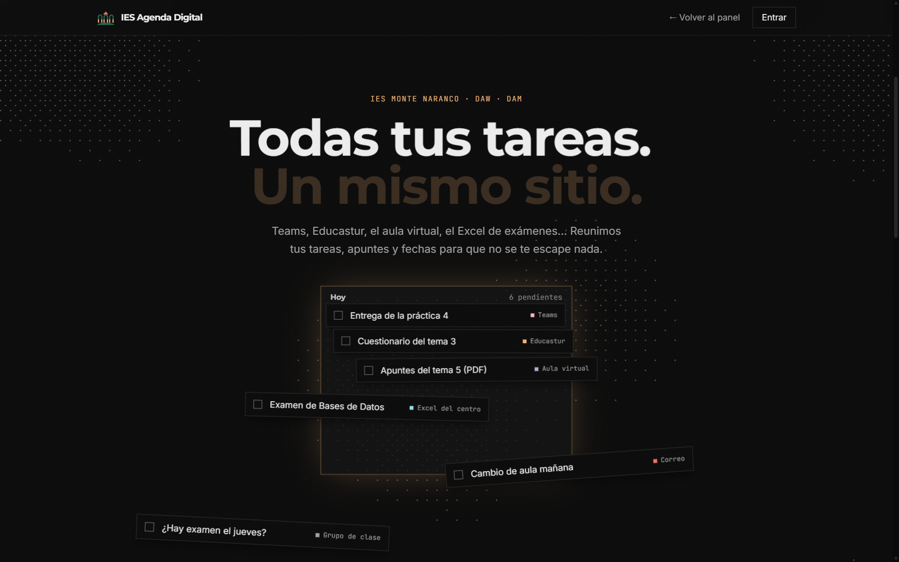
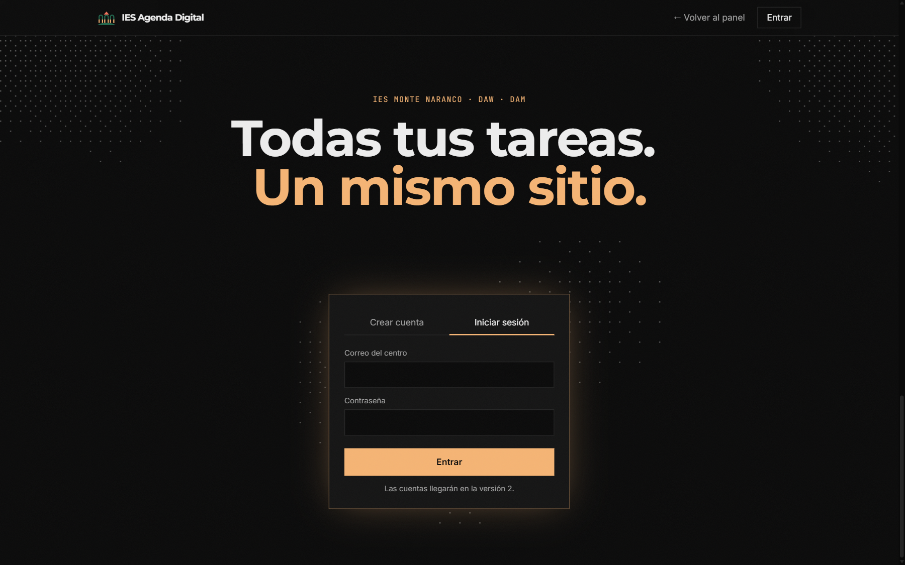
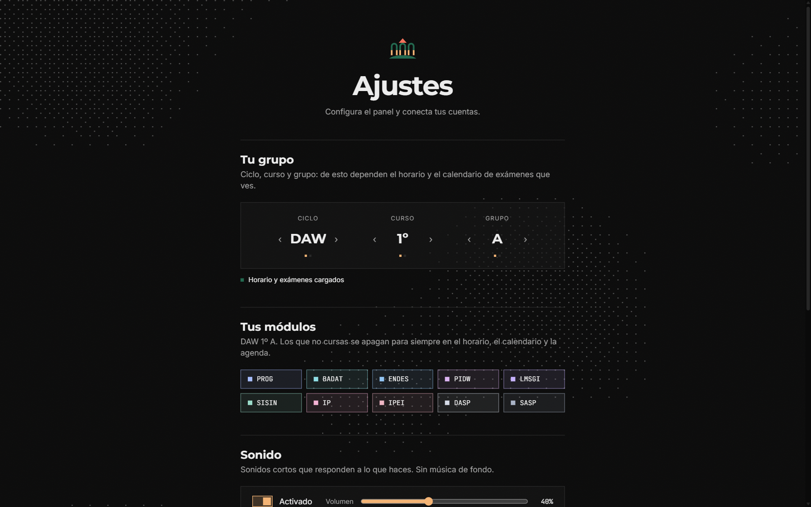
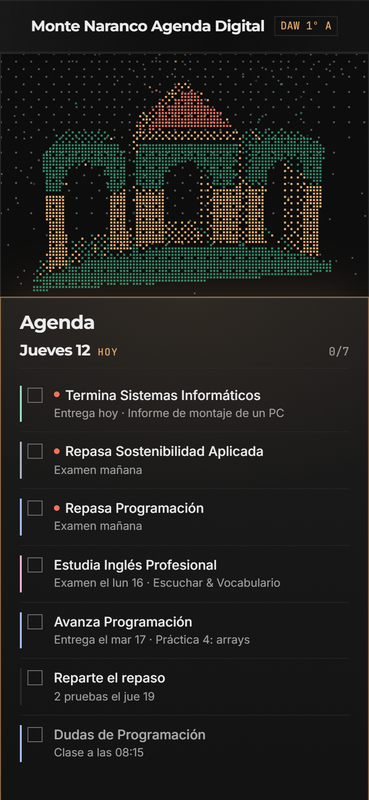

# Monte Naranco Agenda Digital

> Proyecto personal de aprendizaje de un alumno de DAW del IES Monte Naranco. **No es una herramienta oficial del centro.**

Un panel de control para el alumnado que junta en **una sola pantalla** el horario de clase, el calendario de exámenes y entregas, el calendario escolar y una agenda diaria que propone qué hacer hoy. Todo ello con una identidad visual propia basada en el logo del instituto: puntos, tramados, un logo 3D interactivo, una lupa de cristal sobre el horario y sonidos de interfaz.



---

## Índice

- [Qué hace](#qué-hace)
- [Capturas](#capturas)
- [Stack](#stack)
- [Cómo arrancarlo](#cómo-arrancarlo)
- [Estructura del proyecto](#estructura-del-proyecto)
- [Datos](#datos)
- [Accesibilidad y rendimiento](#accesibilidad-y-rendimiento)
- [Estado actual y limitaciones](#estado-actual-y-limitaciones)
- [Hoja de ruta](#hoja-de-ruta)
- [Documentación detallada](#documentación-detallada)
- [Créditos](#créditos)

---

## Qué hace

### Panel principal (`#/`)
En escritorio el panel ocupa **exactamente la pantalla, sin scroll**. Se reparte en una rejilla de cinco celdas:

| Celda | Qué muestra |
|---|---|
| **Cabecera** | A la izquierda, la cuenta atrás hasta la próxima prueba o entrega; a la derecha, hasta la próxima clase. El nombre de la asignatura va en su color. Lleva un efecto de cristal esmerilado. |
| **Horario** | La semana de clases. Una **lupa de cristal (WebGL)** marca el día elegido; se mueve con la rueda del ratón, con las flechas o pulsando el nombre del día, y al pasar del viernes salta de semana. Al pasar el ratón por una asignatura se iluminan todas sus horas; un clic la "apaga" de forma temporal. |
| **Calendario** | Dos modos: **Exámenes** (mes con marcas de color + lista agrupada por semanas, con filtros) y **Escolar** (festivos, días no lectivos y vacaciones del curso 2026-2027). |
| **Logo 3D** | El logo del IES dibujado con puntos como un objeto 3D que gira. Sus partes son botones: el **tejado** lleva a *Registro*, la **puerta central** a *Iniciar sesión*, la **puerta derecha** a *Ajustes* y la **puerta izquierda** a la web del instituto. |
| **Agenda** | Las tareas del día elegido en la lupa, deducidas de las pruebas y del horario ("Termina…", "Repasa…", "Reparte el repaso"…). Se pueden marcar como hechas. Aparece con un efecto de escritura después de un breve estado de "pensando". |

### Ajustes (`#/ajustes`)
- **Tu grupo:** ciclo (DAW / DAM), curso (1º / 2º) y grupo (A / B) con carruseles. De momento solo hay datos de **DAW 1º A**.
- **Tus módulos:** marcar los módulos que no cursas (convalidados). Se guardan en el navegador y desaparecen de toda la web.
- **Sonido:** activar o silenciar y volumen.
- **Sincronizar:** botones de muestra para la futura sincronización con Microsoft 365.

### Landing de acceso (`#/entrar`, `#/crear`)
Una escena única animada con el scroll: unas fichas de distintas plataformas (Teams, Educastur, aula virtual, Excel…) llegan desordenadas, encajan en una lista ("Todas tus tareas. Un mismo sitio.") y la lista deja paso a la tarjeta de inicio de sesión o registro. **Las cuentas aún no existen:** el formulario es de muestra.

### Transversal
- **Transición entre páginas** con una "cortina" de píxeles que nace del punto pulsado.
- **Fondo de puntos animado** en toda la web, con tramado ordenado (dithering de Bayer).
- **Sonidos de interfaz** discretos (muestras de SND y sonidos sintetizados con la Web Audio API).
- **Simulación de fecha** para pruebas: `?ahora=2026-11-12T09:30` en la URL.

---

## Capturas

| Landing: las fichas encajan | Landing: acceso |
|---|---|
|  |  |

| Ajustes | Móvil |
|---|---|
|  |  |

> Las capturas se han hecho con `?ahora=2026-11-12T09:30` (jueves, en mitad de una clase).

---

## Stack

| Pieza | Versión | Para qué |
|---|---|---|
| [React](https://react.dev) | 19 | Interfaz por componentes |
| [TypeScript](https://www.typescriptlang.org) | 6 | Tipos estáticos |
| [Vite](https://vite.dev) | 8 | Servidor de desarrollo y build |
| [Tailwind CSS](https://tailwindcss.com) | 4 | Estilos con tokens de diseño (`@theme`) |
| [Motion](https://motion.dev) | 14 | Animaciones de interfaz (entradas, cambios de estado, arrastre) |
| [GSAP + ScrollTrigger](https://gsap.com) | 3.15 | La escena de la landing ligada al scroll |
| Canvas 2D y WebGL | — | Logo 3D, fondo de puntos, cortina de píxeles y lupa de cristal (sin librerías) |
| Web Audio API | — | Motor de sonido (sin librerías) |
| ESLint | 10 | Calidad del código |

No hay backend: los datos son archivos JSON dentro del proyecto y las preferencias se guardan en `localStorage`.

---

## Cómo arrancarlo

Requisitos: **Node.js 20.19+ o 22.12+** (lo exige Vite 8) y npm.

```bash
npm install        # instala las dependencias (como "mvn install")
npm run dev        # servidor de desarrollo en http://localhost:5173
npm run build      # comprueba tipos y genera la versión de producción en dist/
npm run preview    # sirve dist/ para probar la versión de producción
npm run lint       # revisa el código con ESLint
```

> Ojo: el comando es `npm run dev`, no `npm vite`. `npm` solo entiende sus propios comandos; los del proyecto se lanzan con `npm run <script>`.

### Probar otros momentos
La web depende mucho de la fecha y la hora. Para ver cómo se comporta en otro momento sin esperar:

```
http://localhost:5173/?ahora=2026-11-12T09:30   → jueves, en clase
http://localhost:5173/?ahora=2026-11-04T10:00   → día no lectivo (puente)
http://localhost:5173/?ahora=2026-11-14T12:00   → sábado
```

El reloj simulado avanza normalmente desde ese punto.

---

## Estructura del proyecto

```
src/
├── App.tsx                 # Estado global, rutas y composición del panel
├── main.tsx                # Punto de entrada (fuentes + React)
├── index.css               # Tokens de diseño (colores, fuentes, curvas) y utilidades propias
├── components/
│   ├── sections/           # Las celdas y páginas: Cabecera, HorarioSemanal, Calendario, Agenda, PanelLogo, Ajustes…
│   ├── landing/            # La landing: Landing, Hero (escena GSAP) y Acceso (tarjeta de cuenta)
│   └── ui/                 # Piezas reutilizables: Panel, Logo3D, LupaCristal, FondoPuntos, CortinaPixel, Carrusel, Escritura, Odometro…
├── hooks/                  # useAhora, useRuta, useModulos, useGrupo, useHechas, useAviso, useSonido
├── lib/                    # Lógica sin React: fechas, horario, eventos, calendario escolar, tareas, sonido, cristal (WebGL)…
├── data/                   # JSON: asignaturas, calendario escolar y datos de cada grupo
└── types/                  # Tipos compartidos (Clase, Horario, Evento…)
docs/                       # Esta documentación y sus capturas
public/sonidos/             # Kits de sonido (audio sprites .ogg/.m4a + mapa JSON)
```

La arquitectura completa, el flujo de datos y cada técnica están explicados en [docs/ARQUITECTURA.md](docs/ARQUITECTURA.md).

---

## Datos

| Archivo | Contenido |
|---|---|
| `src/data/asignaturas.json` | Los 10 módulos de DAW 1º: id, nombre corto (máx. ~3 palabras) y nombre oficial completo cuando es más largo. |
| `src/data/grupos/daw1a/horario.json` | Las clases de la semana (día, asignatura, inicio, fin) y el recreo. |
| `src/data/grupos/daw1a/examenes.json` | Exámenes, entregas y evaluaciones con fecha, asignatura y detalle. |
| `src/data/calendario-escolar.json` | Curso 2026-2027: inicio y fin de las clases, festivos, días no lectivos y vacaciones (sacado del calendario escolar oficial del Principado de Asturias). |

Para añadir otro grupo: crear `src/data/grupos/<grupo>/` con su `horario.json` y `examenes.json` y registrarlo en `src/lib/grupos.ts`. Es el único punto de acceso a los datos, pensado para que el día que haya backend solo cambie esa función.

---

## Accesibilidad y rendimiento

- **Movimiento reducido:** con `prefers-reduced-motion` no hay animaciones de entrada, la landing se muestra como página normal, el logo queda quieto y la Agenda aparece sin efecto de escritura.
- **Teclado:** el horario se recorre con ← →, los carruseles también, y todas las zonas del logo son botones reales con su nombre.
- **Lectores de pantalla:** los textos animados (cuenta atrás, escritura) tienen su versión estática en `sr-only`; la lupa y los lienzos decorativos están ocultos para ellos.
- **Móvil primero:** en móvil las celdas se apilan y el panel hace scroll; en escritorio cabe en una pantalla.
- **Rendimiento:** el fondo de puntos se pinta a 30 fps con ondas precalculadas por filas y columnas; el logo 3D se detiene cuando sale de la pantalla (`IntersectionObserver`) y todas las animaciones se pausan con la pestaña en segundo plano; Ajustes y la landing se cargan aparte (*code splitting*) y se precargan cuando el navegador está libre. El JavaScript inicial pesa **~144 kB comprimido**.

---

## Estado actual y limitaciones

Es una **versión 1 solo de frontend**. Lo que conviene saber:

- **Solo hay datos de DAW 1º A.** Los demás grupos muestran un aviso de "sin datos".
- **Las cuentas no existen todavía:** la landing y el formulario son una maqueta.
- **Datos de prueba:** `examenes.json` incluye entregas **inventadas** (5, 6, 9, 10, 12, 17 y 25 de noviembre; 1 y 3 de diciembre) para probar la Agenda. Hay que quitarlas cuando lleguen las fechas reales.
- **Sin sonido hasta el primer clic:** es la política de autoplay de los navegadores; el audio arranca con el primer clic o tecla.
- **Pendientes conocidos:** la barra de la landing aún dice "IES Agenda Digital" (nombre antiguo); el `<title>` de la pestaña y el favicon son provisionales; los módulos apagados se guardan con una clave común a todos los grupos.

---

## Hoja de ruta

### Versión 2: sincronización automática
El calendario de exámenes del centro se lleva en Microsoft 365 (Excel o Word en la web). La idea es leerlo con la **API de Microsoft Graph** en lugar de copiarlo a mano.

A tener en cuenta:
- Hace falta iniciar sesión con la cuenta del centro (autenticación con Microsoft).
- El centro puede bloquear que los alumnos registren aplicaciones.
- Implica algo de backend y gestión de credenciales.

Alternativas más sencillas: que el calendario se comparta como Excel/CSV o como calendario `.ics`.

### Otras ideas
- Cuentas de usuario reales y datos de todos los grupos.
- Tareas propias además de las generadas.
- Despliegue en Vercel o Netlify.
- Tests automáticos (las comprobaciones de este proyecto se hicieron con scripts de Puppeteer fuera del repositorio).

---

## Documentación detallada

- **[docs/PROCESO.md](docs/PROCESO.md):** cómo se hizo, paso a paso: las fases, las decisiones de diseño, los mayores retos técnicos y lo aprendido.
- **[docs/ARQUITECTURA.md](docs/ARQUITECTURA.md):** cómo está hecho por dentro: flujo de datos, cada módulo y cada técnica (z-buffer, shaders, dithering, ScrollTrigger, Web Audio…).

---

## Créditos

- **Logo** del IES Monte Naranco, usado como base del diseño de este proyecto de alumno.
- **Sonidos de interfaz:** [SND](https://snd.dev) de Dentsu Lab Tokyo (kits 01 "Sine" y 03 "Industrial"). El viento, la canica, la marimba y el timbre se sintetizan en el propio proyecto.
- **Tipografías:** Montserrat (la que usa la web del instituto), Inter y JetBrains Mono, vía [Fontsource](https://fontsource.org).
- **Lupa de cristal:** basada en un shader de referencia de tipo *liquid glass*, adaptado para doblar el HTML del horario.
- **Desarrollo:** hecho por un alumno de DAW como proyecto de aprendizaje, programando con ayuda de IA ([Claude Code](https://claude.com/claude-code)). El objetivo era aprender entendiendo cada paso, no solo terminar la web; el proceso está contado en [docs/PROCESO.md](docs/PROCESO.md).
